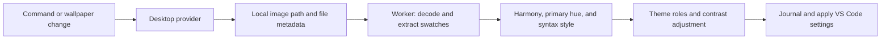

# Architecture

Borrowed Light separates desktop wallpaper discovery from image processing, color generation, and VS Code configuration. The image and its extracted palette are processed locally.

## Code map

| Module | Responsibility |
| --- | --- |
| [src/extension.ts](src/extension.ts) | Commands, settings, sync scheduling, cancellation, and lifecycle |
| [src/model.ts](src/model.ts) | Provider contracts, palette/theme data, preferences, and contrast policy |
| [src/providers.ts](src/providers.ts) | Desktop detection, wallpaper discovery, and change notifications |
| [src/pipeline.ts](src/pipeline.ts), [src/palette-worker.ts](src/palette-worker.ts) | Worker lifecycle and image decoding |
| [src/colors.ts](src/colors.ts) | Palette extraction, harmony recipes, and contrast calculations |
| [src/primary.ts](src/primary.ts), [src/variants.ts](src/variants.ts) | Primary-color choices and rule/appearance combinations |
| [src/syntax.ts](src/syntax.ts), [src/theme.ts](src/theme.ts) | Syntax palettes, semantic roles, workbench colors, and readability adjustments |
| [src/preview.ts](src/preview.ts) | Live QuickPick previews and session caching |
| [src/application.ts](src/application.ts), [src/ownership.ts](src/ownership.ts) | Configuration writes, ownership tracking, rollback, and restoration |
| [src/report.ts](src/report.ts) | Read-only palette and contrast report |
| [syntaxes/python-html.tmLanguage.json](syntaxes/python-html.tmLanguage.json) | Embedded HTML/JavaScript/CSS highlighting in Python multiline strings |

## Sync lifecycle

Manual Sync discovers the configured wallpaper, generates the selected appearance, checks its contrast targets, and applies it. Automatic sync requires `borrowed-light.autoSync` and a selected Borrowed Light theme. Choosing another theme prevents automatic application.

The GNOME provider watches wallpaper settings and desktop appearance changes. A 30-second timer also checks for file changes, including replacement at the same path. Notifications are debounced for 500 ms. A signature combines the wallpaper URI, file size/timestamps/inode, harmony, appearance, primary choices, and syntax style; unchanged automatic requests skip regeneration.

New requests cancel superseded workers. Revision checks prevent stale results from being applied, and configuration writes run through a serial queue. Failures retain the last applied theme; a partially failed application attempts rollback.

### Previews and persistence

The preview prepares all twelve harmony/appearance combinations from one extraction. Primary-hue and syntax-style changes reuse the extracted swatches and cache results for the session. Automatic application waits while the picker is open. A preview starts in the currently active Borrowed Light appearance, even if the saved preference differs.

Enter saves the selected rule, appearance, independent light/dark primary choices, and shared syntax style. Escape restores the starting configuration. A preview journal supports recovery after interruption when the extension next activates.

Generated workbench, TextMate, and semantic-token colors live in theme-specific user-settings blocks. The ownership ledger records original values and the extension's last writes before mutations. Restore removes or reverts only values that still match those writes, preserving later manual edits and unrelated settings. Explicit Sync can overwrite generated keys again.

VS Code Settings Sync can carry generated user settings to another installation. The restoration ledger stays in local extension state, and wallpaper paths are not registered as synced extension-state keys. Disable or uninstall does not automatically restore configuration.

### Configuration reference

All preferences are application-scoped under `borrowed-light.*`.

| Setting suffix | Default | Values |
| --- | --- | --- |
| `harmony` | `analogous` | `analogous`, `monochromatic`, `triad`, `complementary`, `compound`, `shades` |
| `appearance` | `dark` | `dark`, `light`, `desktop` |
| `primaryDark` | `automatic` | `automatic`, `wallpaper-1`…`wallpaper-8`, `harmony-1`…`harmony-5` |
| `primaryLight` | `automatic` | Same source slots, remembered independently |
| `syntaxStyle` | `balanced` | `mellow`, `balanced`, `vibrant`, `vibrant-alt` |
| `autoSync` | `false` | Boolean; enables notifications and periodic checks |

## Platform boundary

`WallpaperProvider` exposes `available()`, `current()`, and optional `watch()` methods. `providerRegistry` selects a provider using the OS and desktop environment. Unsupported desktops receive an explicit unsupported-provider error. Add a provider registration for Windows, macOS, or another Linux desktop without changing extraction or theme generation.

The current provider recognizes Linux GNOME sessions and checks for the GNOME background/interface schemas. It reads `gsettings` with argument arrays, parses GVariant strings, and resolves local `file://` URIs. GNOME's appearance chooses `picture-uri-dark` or `picture-uri`; an unavailable or empty dark key falls back to the regular wallpaper. This image choice follows GNOME independently of VS Code's chosen light/dark appearance.

OS differences belong in providers. Decoding and color extraction are shared TypeScript worker stages, so another platform can reuse the same JPEG/PNG pipeline. The extension runs in the local UI extension host, including when the workspace is remote.

### Image-processing bounds

The worker accepts regular JPEG/PNG files up to 64 MiB and 32 megapixels. It has a 15-second deadline and a 128 MiB old-generation heap limit; the JPEG decoder separately has a 512 MiB allocation budget. These limits constrain processing without claiming to cap total process memory at 128 MiB.

Images are interpreted as sRGB without embedded ICC color management. Transparent pixels are ignored and partially transparent samples are opacity-weighted. Extraction reads the configured image rather than capturing the desktop, so it does not model monitor cropping, overlays, multi-monitor composition, or live transitions.

## Color extraction and harmony

Extraction uses a deterministic, opacity-weighted [median-cut quantizer](https://en.wikipedia.org/wiki/Median_cut) over a bounded, regularly sampled RGB histogram. It returns up to eight representative swatches ordered by sample weight. The first sufficiently chromatic swatch with at least 1% weight seeds the harmony; otherwise, the harmony remains neutral.

Recipes use **OKLCH**: lightness, chroma, and hue angle, the cylindrical representation of Oklab. This separates hue changes from tonal adjustments. Colors outside sRGB reduce chroma to fit the gamut. See [Oklab and OKLCH](https://en.wikipedia.org/wiki/Oklab_color_space) for background and the [W3C CSS Color specification](https://www.w3.org/TR/css-color-4/#ok-lab) for the color-space definition.

The following are Borrowed Light's implementations of familiar [color-scheme concepts](https://en.wikipedia.org/wiki/Color_scheme). Hue angles are measured in OKLCH; the recipes do not promise to reproduce another tool's color wheel.

| Rule | Approach in Borrowed Light | Theory background |
| --- | --- | --- |
| Analogous | Seed hue and neighbors at ±30° and ±60° | [Adjacent hues](https://en.wikipedia.org/wiki/Color_scheme#Analogous) |
| Monochromatic | One hue with five lightness/chroma combinations | [Monochromatic schemes](https://en.wikipedia.org/wiki/Color_scheme#Monochromatic) |
| Triad | Seed, +120°, +240°, plus two tonal variants | [Evenly spaced hues](https://en.wikipedia.org/wiki/Color_scheme#Evenly_spaced_hues) |
| Complementary | Seed and +180° complement, plus tonal variants | [Complementary schemes](https://en.wikipedia.org/wiki/Color_scheme#Complementary) |
| Compound | Seed, ±30° neighbors, and +150°/+210° split complements | [Split-complementary background](https://en.wikipedia.org/wiki/Color_scheme#Complementary); the five-color combination is this project's recipe |
| Shades | Seed hue/chroma with descending lightness | [Tints and shades](https://en.wikipedia.org/wiki/Tint,_shade_and_tone) |

Harmony colors may be derived rather than observed in the image. Primary-hue selection offers extracted swatches and harmony slots separately. Preferences store source slots rather than fixed hex values; a missing slot falls back to Automatic. Changing the primary hue changes surfaces and accents without changing the harmony recipe.

Light surfaces use weighted wallpaper lightness/chroma and the selected primary hue to vary their brightness and tint. Grayscale wallpapers remain neutral.

## Syntax palette selection

Syntax roles cover keywords, strings, numbers/constants, functions, types, and identifiers. Both TextMate and semantic-token rules receive assignments. The syntax styles are project-specific design choices, informed by hue spacing and chroma rather than a separate standardized color harmony.

| Style | Color source and adjustment | Identifier treatment |
| --- | --- | --- |
| Mellow | Harmony palette with strongly reduced chroma | Close to primary text color |
| Balanced | Harmony palette with moderate chroma | Neutral identifiers; default style |
| Vibrant | Separated observed wallpaper hues plus harmony/derived accents, with stronger chroma | Colorful variables, parameters, and properties |
| Vibrant Alternate | Same vibrant palette, rotated by one source slot | Different assignment of colors to syntax families |

Vibrant selection first chooses separated observed hues, then combines them with harmony candidates. It favors candidates at least 40° from already selected hues. If fewer than six sufficiently distinct sources exist, it derives more accents by bisecting the largest remaining hue-wheel gaps. This keeps a mostly green wallpaper from making every syntax family green. Derived accents are not reported as extracted wallpaper colors; fully grayscale sources remain neutral.

Token lightness is chosen for light or dark backgrounds, then each role goes through the contrast adjustment below. Comments and punctuation remain restrained. Syntax style is shared between appearances and does not change the primary hue or workbench palette.

The Python grammar injection recognizes HTML document roots inside ordinary/raw multiline strings and delegates HTML, script, and style content to existing language grammars. Ordinary strings retain Python coloring, and formatted strings retain Python interpolation handling. This contribution applies across themes while the extension is enabled.

## Contrast measurement and adjustment

Readability uses the WCAG relative-luminance contrast ratio, distinct from visual hue separation. sRGB channels are linearized, then combined as `Y = 0.2126 R + 0.7152 G + 0.0722 B`. Contrast is `(lighter Y + 0.05) / (darker Y + 0.05)`, ranging from 1:1 to 21:1. See [W3C's contrast explanation](https://www.w3.org/WAI/WCAG22/Understanding/contrast-minimum.html).

The current `balancedPolicy` targets **4.5:1** for primary/secondary text, comments, syntax categories, buttons, and field text against their assigned backgrounds. Essential focus indicators target **3:1**, informed by [W3C non-text contrast guidance](https://www.w3.org/WAI/WCAG22/Understanding/non-text-contrast.html).

`readable()` searches for the nearest passing OKLCH lightness while retaining the source hue/chroma where gamut permits. It checks the final quantized 8-bit sRGB hex values against every background assigned to that role. Black/white are fallbacks; an impossible assignment raises an error rather than silently returning a failing color.

The report shows pairwise contrast matrices for extracted/harmony palettes, role adjustments, and foreground/background checks. An arbitrary pair of palette colors has no universal pass/fail requirement; its assigned UI role determines the target.

These checks cover controlled theme roles, not every rendered pixel or an overall WCAG conformance claim. Workspace/language overrides, additional token scopes, third-party webviews, transparency, and terminal programs can change actual pairings. Diagnostic and terminal status colors preserve recognizable meanings rather than strictly following the harmony.

## Extension points

- Add OS/desktop discovery and notifications through `WallpaperProvider` and `providerRegistry`.
- Add image formats in the worker without coupling extraction to the desktop provider.
- Extend harmony and syntax strategies through the palette/variant stages.
- Add future high-contrast or focused modes through `ContrastPolicy`, preserving primary text requirements while adjusting secondary/comment emphasis. Only the balanced policy is currently exposed.

See [Developing](DEVELOPING.md) for build and test workflows, or return to the [user guide](README.md).
