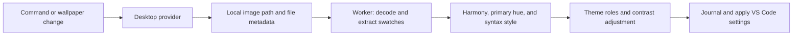

# Architecture

Borrowed Light separates desktop wallpaper discovery from image processing, color generation, and VS Code configuration. The image and its extracted palette are processed locally.

## Code map

| Module | Responsibility |
| --- | --- |
| [src/extension.ts](src/extension.ts) | Commands, settings, sync scheduling, cancellation, and lifecycle |
| [src/model.ts](src/model.ts) | Provider contracts, palette/theme data, preferences, and contrast policy |
| [src/platform/os_detect.ts](src/platform/os_detect.ts), [src/platform/os_wallpaper.ts](src/platform/os_wallpaper.ts) | OS/desktop detection, provider override routing, and native decoder selection |
| [src/platform/](src/platform/) | Windows/macOS helpers and Linux desktop implementations, plus provider/decoder contracts |
| [src/image/](src/image/) | Portable file URIs, bounded file reads, JPEG/PNG decoding, and image limits |
| [src/pipeline.ts](src/pipeline.ts), [src/palette-worker.ts](src/palette-worker.ts) | Worker lifecycle, native-conversion requests, and palette generation |
| [src/color/code.ts](src/color/code.ts), [src/color/conversion.ts](src/color/conversion.ts) | Validated hex colors and the Culori/OKLCH adapter |
| [src/color/extraction.ts](src/color/extraction.ts) | Sampling, opacity-weighted histogram, and median-cut swatches |
| [src/color/harmony.ts](src/color/harmony.ts), [src/color/contrast.ts](src/color/contrast.ts) | Harmony recipes, luminance/contrast, and readability search |
| [src/primary.ts](src/primary.ts), [src/variants.ts](src/variants.ts) | Primary-color choices and rule/appearance combinations |
| [src/color/syntax.ts](src/color/syntax.ts), [src/color/theme.ts](src/color/theme.ts) | Syntax palettes, semantic roles, workbench colors, and readability adjustments |
| [src/preview.ts](src/preview.ts) | Live QuickPick previews and session caching |
| [src/application.ts](src/application.ts), [src/ownership.ts](src/ownership.ts) | Configuration writes, ownership tracking, rollback, and restoration |
| [src/report.ts](src/report.ts) | Read-only palette and contrast report |
| [syntaxes/python-html.tmLanguage.json](syntaxes/python-html.tmLanguage.json) | Embedded HTML/JavaScript/CSS highlighting in Python multiline strings |

## Sync lifecycle

Manual Sync discovers the configured wallpaper, generates the selected appearance, checks its contrast targets, and applies it. Automatic updates require a selected Borrowed Light theme and at least one enabled source: `borrowed-light.autoSync` for wallpaper changes, or `appearance: desktop` for system mode. Appearance-only updates use the persisted palette without reopening the wallpaper. Choosing another theme prevents automatic application.

The GNOME provider watches wallpaper settings and desktop appearance changes. macOS watches its wallpaper store directory and polls wallpaper/appearance every five seconds. Windows uses registry notifications and recursive wallpaper-cache watching, with a five-minute safety check. A failed Windows monitor falls back to 30-second checks; the other providers retain their existing 30-second safety timer. These checks catch missed events and source file replacement at the same path. Notifications are debounced for 500 ms. A signature combines the wallpaper URI, file size/timestamps/inode, harmony, appearance, primary choices, syntax style, border contrast, and active background tint; unchanged automatic requests skip regeneration.

New requests cancel superseded workers. Revision checks prevent stale results from being applied, and configuration writes run through a serial queue. Failures retain the last applied theme; a partially failed application attempts rollback.

### Previews and persistence

The preview prepares all twelve harmony/appearance combinations from one extraction. Primary-hue and syntax-style changes reuse the extracted swatches and cache results for the session. Automatic application waits while the picker is open. A preview starts in the currently active Borrowed Light appearance, even if the saved preference differs.

Enter saves the selected rule, independent light/dark primary choices, and shared syntax style and border contrast. Escape restores the starting configuration. A preview journal supports recovery after interruption when the extension next activates.

Generated workbench, TextMate, and semantic-token colors live in theme-specific user-settings blocks. The ownership ledger records original values and the extension's last writes before mutations. Restore removes or reverts only values that still match those writes, preserving later manual edits and unrelated settings. Explicit Sync can overwrite generated keys again.

VS Code Settings Sync can carry generated user settings to another installation. The restoration ledger stays in local extension state, and wallpaper paths are not registered as synced extension-state keys. Disable or uninstall does not automatically restore configuration.

### Configuration reference

All preferences are application-scoped under `borrowed-light.*`.

| Setting suffix | Default | Values |
| --- | --- | --- |
| `harmony` | `analogous` | `analogous`, `monochromatic`, `triad`, `complementary`, `compound`, `shades` |
| `appearance` | `desktop` | `dark`, `light`, `desktop` |
| `primaryDark` | `automatic` | `automatic`, `wallpaper-1`…`wallpaper-8`, `harmony-1`…`harmony-5` |
| `primaryLight` | `automatic` | Same source slots, remembered independently for the current wallpaper |
| `syntaxStyle` | `balanced` | `mellow`, `balanced`, `vibrant`, `vibrant-alt` |
| `borderContrast` | `balanced` | `mellow`, `balanced`, `vibrant`; independent decorative pane contrast |
| `platformProvider` | `auto` | `auto`, `windows`, `macos`, `linux-gnome`; overrides must match the host OS |
| `autoSync` | `true` | Wallpaper following; migration preserves the previous effective value for existing installations |
| `backgroundTintLight` | `subtle` | `subtle`, `balanced`, `colorful`; light surface saturation |
| `backgroundTintDark` | `colorful` | Same options; default retains original dark styling |
| `maxImageMegapixels` | `256` | Integer 1–512; source acceptance limit, independent of process memory |

## Platform boundary

OS-specific code lives under `src/platform/`: `windows/`, `macos/`, and `linux/gnome/`. Future Linux desktop implementations get sibling subfolders under `linux/`. Linux commands use argument arrays; no user-controlled shell expression is evaluated.

`os_detect.ts` returns a typed OS and Linux desktop identity, with `UNKNOWN` and raw session identifiers for diagnostics. It uses Node's host platform and recognizes colon-separated `XDG_CURRENT_DESKTOP` values, then falls back to `DESKTOP_SESSION`. Recognizing a desktop does not imply provider support.

`os_wallpaper.ts` selects a `WallpaperProvider` with `available()`, `current()`, and optional `watch()` methods. Automatic selection chooses Windows, macOS, or Linux/GNOME. The `platformProvider` setting can select an implemented provider explicitly when session detection is ambiguous; incompatible OS overrides fail clearly. A change stops old monitors and pending generations, reprobes the provider, and waits for that probe before new reads. Unsupported/unavailable providers report the detected environment or missing capability.

GNOME checks background/interface schemas, reads `gsettings`, and parses quoted GVariant strings. GNOME's appearance chooses `picture-uri-dark` or `picture-uri`; an unavailable/empty dark key falls back to the regular wallpaper. Its settings monitors are retained.

Windows runs fixed PowerShell/C# code using built-in Windows PowerShell. [IDesktopWallpaper](https://learn.microsoft.com/en-us/windows/win32/api/shobjidl_core/nn-shobjidl_core-idesktopwallpaper) supplies per-monitor wallpaper paths. The helper queries primary Win32 monitor geometry, and the TypeScript boundary matches it to the wallpaper monitor rectangles rather than assuming enumeration order. Appearance follows `SystemUsesLightTheme`. No wallpaper settings are changed.

While auto-sync is enabled, one hidden Windows PowerShell helper blocks on [RegNotifyChangeKeyValue](https://learn.microsoft.com/en-us/windows/win32/api/winreg/nf-winreg-regnotifychangekeyvalue) events for `HKCU\Control Panel\Desktop` and `HKCU\Software\Microsoft\Windows\CurrentVersion\Themes` (including subkeys). It rearms each one-shot registration before notifying the extension. A recursive `fs.watch` on `%APPDATA%\Microsoft\Windows\Themes` covers wallpaper cache replacements and per-monitor/slideshow updates. Startup is bounded; failures are logged and enable the fallback timer. Disposal kills the helper and closes the file watcher; stdin EOF also stops the helper when the extension host exits. This adds no package dependencies or platform-specific binaries, and the helper starts only for the Windows provider.

macOS runs fixed JavaScript/Objective-C bridge code with `/usr/bin/osascript`. AppKit's first screen identifies the primary/menu-bar display; [NSWorkspace.desktopImageURL](https://developer.apple.com/documentation/appkit/nsworkspace/desktopimageurl(for:)) provides the legacy fallback. Modern image/aerial selections come from the primary display or shared entry in the user's wallpaper store; aerials use the local cached preview, since NSWorkspace can return a stale default image. The store is undocumented and may change between OS releases. Appearance reads the global AppleInterfaceStyle preference in a fresh helper. The implementation uses framework calls rather than controlling Finder/System Events through Apple Events.

The local UI extension host owns platform helpers, including in remote workspaces. Helpers use fixed source and argument-based execution with bounded stdout/stderr, deadlines, and process termination on cancellation. Windows image paths and policy travel as JSON through stdin; macOS image paths travel as literal sips arguments. No external installations or native Node modules are required.

### Native image fallback

JPEG/PNG detection uses file signatures rather than extensions. Windows normalizes through WPF/WIC (including BMP), macOS through its built-in sips utility (including HEIC), and Linux through the bundled portable decoder. Every path returns a PNG with a maximum 1024-pixel edge, preserving smaller images. Corrupt images are not retried through a different backend.

The palette worker requests normalization of the parent-owned input path. The extension host owns the native subprocess or portable worker and returns normalized bytes; the job deadline includes conversion. Abort, disposal, timeout, or worker failure stops the outstanding helper, and the pipeline waits for cleanup before settling. macOS uses a private temporary directory for normalization and removes it on success, failure, or cancellation. Windows receives the literal path and policy as UTF-8 JSON on stdin, without interpolating paths into script source.

Multi-image files use the first still frame. Windows slideshows use the current file reported by the OS; active macOS dynamic frame selection, animations, cropping, and screenshot capture are outside this release. Native codec availability depends on the OS. Built-in helper restrictions and unsupported formats produce errors while retaining the last applied theme.

### Image-processing bounds

Source admission is shared across platforms: 256 MP by default, configurable to 1–512 MP, at most 2 GiB, and at most 65,500 pixels per edge (libjpeg's guarded maximum). `src/image/policy.ts` owns the policy; bounded signature/header inspection rejects excessive JPEG/PNG dimensions before raster allocation. Windows and macOS also check native-format dimensions inside their adapters. The configured limit participates in cache identity. Source reads are preflighted before cache reuse; frozen palettes can be reused without reopening the source.

Windows/macOS normalize through their native adapters; Linux uses the bundled WASM adapter built from libjpeg-turbo, libpng, and zlib. The portable adapter is also selectable for development profiling on Windows/macOS. Source files are read directly from disk; full compressed sources do not travel through worker messages. The parent serializes normalization and owns cancellation/cleanup. Portable jobs use a fresh worker and WASM instance, with reduced JPEG decoding and row/pass-based PNG thumbnail accumulation. Progressive JPEG coefficient storage can still grow with source pixels.

Only normalized images enter the palette decoder: PNG up to 8 MiB and a maximum 1024-pixel edge. Palette processing has a 15-second deadline; the entire file job, including normalization, has a 120-second deadline. Workers retain a 128 MiB old-generation JS heap limit. This does not cap Buffer, WASM, helper, or total process memory; the portable WASM address space can grow to 4 GiB. See `codec/README.md` for pinned sources and rebuild instructions.

The shared JPEG/PNG decoder interprets samples as sRGB without embedded ICC color management; native normalization may perform OS codec color conversions. Transparent pixels are ignored and partially transparent samples are opacity-weighted. Extraction reads the configured image rather than capturing the desktop, so it does not model monitor cropping, overlays, multi-monitor composition, or live transitions.

## Color representations and boundaries

Related calculations live under `src/color/`. `HexColorCode` is a branded string representing exactly an opaque `#RRGGBB` sRGB value. `parseHexColorCode()` validates boundary values, and `isHexColorCode()` narrows unknown values. Accepted spelling is preserved. Shorthand, alpha channels, named colors, and malformed values are excluded from calculations. Brands add no JSON fields and remain ordinary strings in worker messages and VS Code settings.

`toOklch()` and `fromOklch()` exchange an `OklchColor` with named `lightness`, `chroma`, and `hueDegrees` coordinates. Culori's abbreviated coordinates stay inside the conversion adapter. Supplied worker swatches are validated after structured cloning. The report validates raw customization colors separately; unsupported formats are shown as escaped text rather than measured as opaque colors.

Policy constants are grouped beside the algorithms they govern. WCAG coefficients and thresholds are distinguished from custom visual choices such as sampling bounds, recipe stops, hue separation, and saturation limits. Syntax generation returns named family colors instead of numeric slots.

## Color extraction and harmony

Extraction uses a deterministic, opacity-weighted [median-cut quantizer](https://en.wikipedia.org/wiki/Median_cut) over a bounded, regularly sampled RGB histogram. `extractRepresentativeColors()` builds five-bit RGB bins on a regular grid targeting 65,536 samples. It splits the box with the largest channel range × opacity mass at its weighted median, using stable channel/box ordering to resolve ties. Rounded RGB centroids with the same hex value are merged. It returns up to eight representative swatches ordered by sample weight. `generateHarmonyPalette()` uses the first sufficiently chromatic swatch with at least 1% weight seeds the harmony; otherwise, the harmony remains neutral.

Recipes use **OKLCH**: lightness, chroma, and hue angle, the cylindrical representation of Oklab. This separates hue changes from tonal adjustments. Colors outside sRGB reduce chroma to fit the gamut. See [Oklab and OKLCH](https://en.wikipedia.org/wiki/Oklab_color_space) for background and the [W3C CSS Color specification](https://www.w3.org/TR/css-color-4/#ok-lab) for the color-space definition.

The following are Borrowed Light's implementations of familiar [color-scheme concepts](https://en.wikipedia.org/wiki/Color_scheme). Hue angles are measured in OKLCH; the recipes do not promise to reproduce another tool's color wheel.

| Rule | Approach in Borrowed Light | Theory background |
| --- | --- | --- |
| Analogous | Seed hue and neighbors at ±30° and ±60° | [Adjacent hues](https://en.wikipedia.org/wiki/Color_scheme#Analogous) |
| Monochromatic | One hue with five lightness/chroma combinations | [Monochromatic schemes](https://en.wikipedia.org/wiki/Color_scheme#Monochromatic) |
| Triad | Seed, +120°, +240°, plus two tonal variants | [Evenly spaced hues](https://en.wikipedia.org/wiki/Color_scheme#Evenly_spaced_hues) |
| Complementary | Seed and +180° complement, plus tonal variants | [Complementary schemes](https://en.wikipedia.org/wiki/Color_scheme#Complementary) |
| Compound | Seed, ±30° neighbors, and +150°/+210° split complements | [Split-complementary background](https://en.wikipedia.org/wiki/Color_scheme#Complementary); the five-color combination is this project's recipe |
| Shades | Seed hue/chroma with descending lightness | [Tints and shades](https://en.wikipedia.org/wiki/Tint,_shade_and_tone) |

Harmony colors may be derived rather than observed in the image. Primary-hue selection offers extracted swatches and harmony slots separately. Preferences store source slots rather than fixed hex values; a missing slot falls back to Automatic. Changing the primary hue changes surfaces and accents without changing the harmony recipe.

Light surfaces use weighted wallpaper lightness/chroma and the selected primary hue to vary their brightness and tint. Grayscale wallpapers remain neutral.

## Syntax palette selection

Syntax roles cover keywords, strings, numbers/constants, functions, types, and identifiers. Both TextMate and semantic-token rules receive assignments. The syntax styles are project-specific design choices, informed by hue spacing and chroma rather than a separate standardized color harmony.

| Style | Color source and adjustment | Identifier treatment |
| --- | --- | --- |
| Mellow | Harmony palette with moderate chroma; retains the former Balanced treatment | Neutral identifiers |
| Balanced | Prioritize separated colorful wallpaper swatches, then harmony hues; boost chroma and foreground/background separation | Neutral identifiers; default style |
| Vibrant | Separated observed wallpaper hues plus harmony/derived accents, with stronger chroma | Colorful variables, parameters, and properties |
| Vibrant Alternate | Same vibrant palette, rotated by one source slot | Different assignment of colors to syntax families |

Balanced starts with observed colorful wallpaper swatches separated by at least 25°, preserving small highlights even when the harmony is monochromatic. It fills remaining slots with sufficiently separated harmony colors, without deriving extra hues. Its darker light-theme foregrounds and brighter dark-theme foregrounds provide stronger contrast; final quantized colors still pass the shared contrast checks.

Vibrant selection first chooses separated observed hues, then combines them with harmony candidates. It favors candidates at least 40° from already selected hues. If fewer than six sufficiently distinct sources exist, it derives more accents by bisecting the largest remaining hue-wheel gaps. This keeps a mostly green wallpaper from making every syntax family green. Derived accents are not reported as extracted wallpaper colors; fully grayscale sources remain neutral.

Token lightness is chosen for light or dark backgrounds, then each role goes through the contrast adjustment below. Comments and punctuation remain restrained. Syntax style is shared between appearances and does not change the primary hue or workbench palette.

The Python grammar injection recognizes HTML document roots inside ordinary/raw multiline strings and delegates HTML, script, and style content to existing language grammars. Ordinary strings retain Python coloring, and formatted strings retain Python interpolation handling. This contribution applies across themes while the extension is enabled.

## Contrast measurement and adjustment

Readability uses the WCAG relative-luminance contrast ratio, distinct from visual hue separation. sRGB channels are linearized, then combined as `Y = 0.2126 R + 0.7152 G + 0.0722 B`. Contrast is `(lighter Y + 0.05) / (darker Y + 0.05)`, ranging from 1:1 to 21:1. See [W3C's contrast explanation](https://www.w3.org/WAI/WCAG22/Understanding/contrast-minimum.html).

The current `balancedPolicy` targets **4.5:1** for primary/secondary text, comments, syntax categories, buttons, and field text against their assigned backgrounds. Essential focus indicators target **3:1**, informed by [W3C non-text contrast guidance](https://www.w3.org/WAI/WCAG22/Understanding/non-text-contrast.html).

`ensureReadableColor()` searches for the nearest passing OKLCH lightness while retaining the source hue/chroma where gamut permits. It checks the final quantized 8-bit sRGB hex values against every background assigned to that role. The search visits 1,001 lightness values from 0 to 1; strict distance comparisons retain the earlier (darker) candidate on equal distances. This search resolution is a custom policy. Black/white are fallbacks; an impossible assignment raises an error rather than silently returning a failing color.

The report shows pairwise contrast matrices for extracted/harmony palettes, role adjustments, and foreground/background checks. An arbitrary pair of palette colors has no universal pass/fail requirement; its assigned UI role determines the target.

These checks cover controlled theme roles, not every rendered pixel or an overall WCAG conformance claim. Workspace/language overrides, additional token scopes, third-party webviews, transparency, and terminal programs can change actual pairings. Diagnostic and terminal status colors preserve recognizable meanings rather than strictly following the harmony.

## Extension points

- Add OS/desktop discovery and notifications through `WallpaperProvider` and `providerRegistry`.
- Add portable formats in `src/image/` or native codecs under `src/platform/`, keeping extraction independent of discovery.
- Extend harmony and syntax strategies through the palette/variant stages.
- Add future high-contrast or focused modes through `ContrastPolicy`, preserving primary text requirements while adjusting secondary/comment emphasis. Only the balanced policy is currently exposed.

See [Developing](DEVELOPING.md) for build and test workflows, or return to the [user guide](README.md).

Decorative pane/widget borders have an independent `borderContrast` preference. Mellow and Balanced use muted surface hues with custom minimum contrast targets of 1.15:1 and 1.5:1 against editor, panel, and field surfaces. Vibrant preserves the original indicator color. Keyboard focus, search matches, and control outlines keep the existing indicator contrast policy. Border preference is included in pipeline inputs, preview caches, signatures, and the report; only accepting a preview writes its new setting.

Preview light/dark appearance is transient: committing a preview never writes the appearance preference. The desktop-following command freezes the active editor appearance when following is turned off. `WallpaperPrimaries` persists the last successfully used source signature separately from appearance/syntax; a changed source uses automatic primaries, and a successful sync resets both primary settings. Accepted previews bind their hue choices to the source they sampled. Failed syncs and cancelled previews do not advance the binding. Existing unbound preferences migrate on the first successful sync.

## Independent synchronization and onboarding

Providers expose `appearance()` separately from wallpaper discovery. Monitoring runs when either wallpaper following or system appearance following is enabled. Appearance-only updates regenerate from locally persisted swatches and never stat/decode the current wallpaper. Successful manual syncs and accepted previews refresh that snapshot. Automatic writes remain gated by the active Borrowed Light theme and the existing cancellation/ownership mechanisms.

A versioned installation marker distinguishes first setup from later activation; existing state or explicit preferences suppress automatic theme selection and onboarding. Migration retains the old effective wallpaper sync default. Explicit visual setting changes can regenerate the frozen palette even when both automatic sources are disabled. The welcome page uses a script-free webview with allowlisted commands and reports actual setup success/failure.

Light and dark tint settings are independent. Light defaults to subtle (surface chroma capped at 0.018 after scaling); dark defaults to colorful, preserving prior output. Colorful uses the original surface policy. Tint does not modify the swatches supplied to syntax palette generation.
